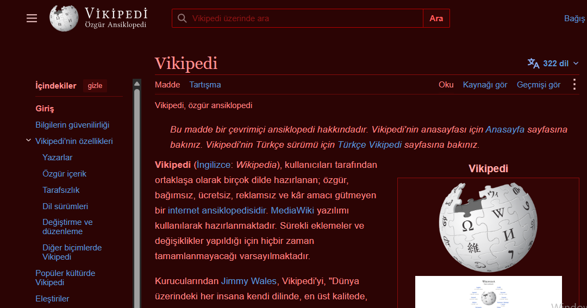

  

  
  
  

  <strong>TR: Web sitenizi kırmızı ile değiştirin!</strong> 
  <strong>EN: Change your website to red!</strong>

  <a href="#-türkçe-kullanım-kılavuzu">🇹🇷 Türkçe Kullanım Kılavuzu</a> • 
  <a href="#-english-guide">🇬🇧 English Guide</a>

---

## 🇹🇷 Türkçe Kullanım Kılavuzu

Eğer kırmızıyı çok seviyorsanız, web sitenizin temasını kırmızı yapın!

### 🚀 Nasıl Uygulanır?

1. **Eklentiyi İndirin:**
   * 🌐 [Chrome / Edge için Dark Reader](https://chromewebstore.google.com/detail/dark-reader/eimadpbcbfnmbkopoojfekhnkhdbieeh)
   * 🦊 [Firefox için Dark Reader](https://addons.mozilla.org/en-US/firefox/addon/darkreader/)

2. **Gelişmiş Ayarları Açın:**
   * Eklenti simgesine tıklayın.
   * **Daha Fazla** > **Tüm Ayarlar** > **Gelişmiş** (veya *Advanced*) yolunu izleyin.
   * **"Enable Prototype Design"** seçeneğini aktif edin ve pencereyi kapatın.

3. **Renkleri Ayarlayın:**
   * Eklentiyi tekrar açın ve **Tüm Seçenekleri Gör** (*See all options*) > **Renkler** (*Colors*) bölümüne gidin.
   * Aşağıdaki HEX renk kodlarını ilgili alanlara yazın:
     * ⬛ **Arkaplan (Background):** `#2b0404`
     * 📝 **Yazı (Text):** `#ffaaaa`
     * 🎯 **Seçim (Selection):** `#cc0000`

4. **Uygulayın ve Bitti!** 🎉

Ve web sitelerinin teması böyle olacaktır:

---

## 🇬🇧 English Guide

If you love red, make your website theme red!

### 🚀 How to Apply?

1. **Download the Extension:**
   * 🌐 [Dark Reader for Chrome / Edge](https://chromewebstore.google.com/detail/dark-reader/eimadpbcbfnmbkopoojfekhnkhdbieeh)
   * 🦊 [Dark Reader for Firefox](https://addons.mozilla.org/en-US/firefox/addon/darkreader/)

2. **Enable Advanced Settings:**
   * Click on the extension icon.
   * Navigate to **More** > **All Settings** > **Advanced**.
   * Check **"Enable Prototype Design"** and close the settings panel.

3. **Set the Colors:**
   * Open the extension again, go to **See all options** > **Colors**.
   * Enter the following HEX color codes:
     * ⬛ **Background:** `#2b0404`
     * 📝 **Text:** `#ffaaaa`
     * 🎯 **Selection:** `#cc0000`

4. **Apply and Done!** 🎉

And the theme of the websites will look like this:

